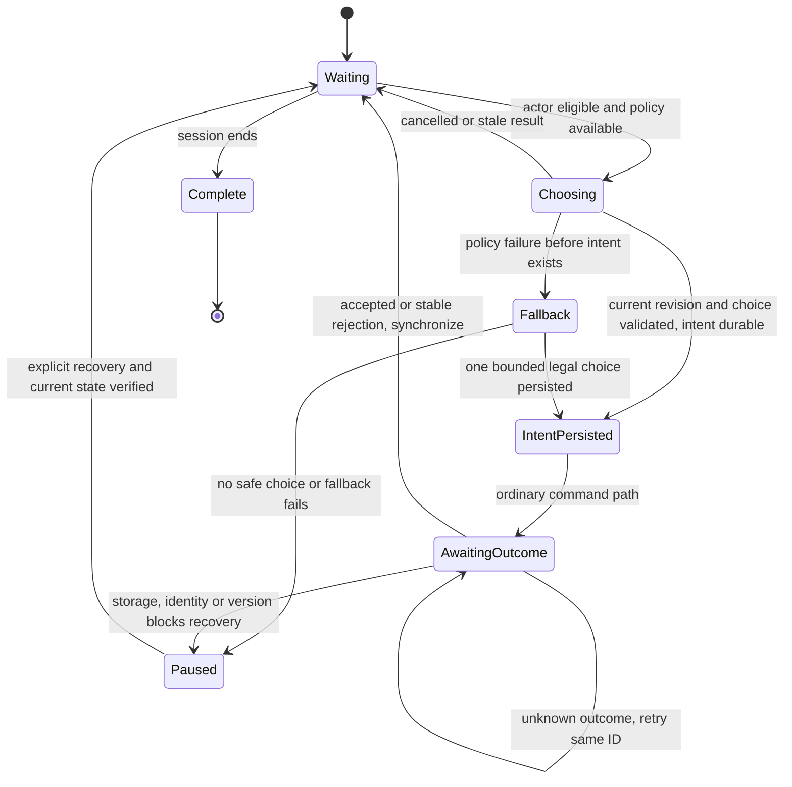

# Catan bot requirements

Version 1.1 · 2026-11-01 · Acceptance baseline; see [implementation evidence](CATAN_FULL_GAME.md).
Product requirements supplement to [PRD 3.2](../PRD.md); architecture context: [HLD](HLD.md).

## 1. Purpose and scope

Bots serve two needs: fill otherwise empty seats so two friends can play a three-player Catan game, and exercise game rules/recovery through repeatable automated play. They are game participants, not a second rule engine or a privileged debugging interface.

Use an existing open-source policy where practical. Selection/adaptation follows these requirements; the implementation record below identifies the selected adaptation. Start with ordinary deterministic heuristics or seeded selection among legal actions. Learned policies/search can be added later behind the same boundary. No LLM/API subscription, model training, competitive playing-strength claim or new self-managed server is required for the first bot.

| Stage | Required deliverable | Dependencies / limits |
|---|---|---|
| B1 — local setup bots | Host chooses human/bot seats before starting. Bots place settlements/roads through the existing setup authority; local saves, backups and offline recovery preserve them. | Current shared-iPad setup only. Does not add Catan room joining or full gameplay. B1 requirements are independently releasable. |
| B2 — base-game bots and simulation | Bots complete every decision phase supported by the scoped base game; a headless runner produces reproducible games and failure artifacts. | Requires complete shared base rules, legal-decision discovery, durable session state and private views. Add coverage alongside each phase rather than waiting for a large rewrite. |
| B3 — internet mixed games | Two people on separate devices invite each other and play against one bot; support three/four total seats. | Requires Catan rooms, managed authority, identity binding, recovery and privacy controls. Bots do not solve networking by themselves. |

Human play supports one or more humans with enough bots to make three or four seats; the required mixed case is two humans plus one bot. All-bot games are mandatory for automated tests, not a requirement to expose an unattended simulator in the public app. Expansion rules, automatic takeover of disconnected humans, mid-game seat conversion and expansion-specific bots are out of scope initially. The original internet pilot supported exactly two humans and one bot. On 2026-11-02 the owner added optional solo internet play with one human and two bots (M-17); four-seat configurations remain follow-up requirements.

## 2. User stories

| Story | Acceptance |
|---|---|
| BS-01 — Play with a friend | Given two human seats and one bot, the three-seat configuration is valid. In B1 the humans share an iPad; in B3 they join from separate devices. No bot account/login form is needed. |
| BS-02 — Practice alone | One human can fill the other two or three seats with bots. Bot seats are visibly labeled; the player can distinguish thinking, committed action and failure. |
| BS-03 — Reproduce a bug | Given a recorded initial scenario, rules/policy versions, independent random seeds and ordered external inputs, the runner reproduces the decision/command trace or identifies an incompatible dependency. |
| BS-04 — Resume safely | Closing the app or restarting the authority while a bot acts recovers the same unresolved command and seat. No extra settlement, road or other move is produced. |
| BS-05 — Play fairly | A bot only receives its authorized observation and legal choices, including its own private data. Changing opponents' unrevealed cards while holding the observation/seed fixed cannot change its choice. |

## 3. Functional and operational requirements

All rows are mandatory for their first applicable stage unless marked later. Existing PRD security, persistence, language and update requirements also apply.

| ID / first stage | Requirement and acceptance criteria |
|---|---|
| BOT-01 / B1 | **Explicit seat configuration.** Before starting, choose human/bot per seat for three/four total players. Support two humans + one bot, one human + two/three bots, and all-bot test sessions. Persist seat kind and policy selection. Randomized turn order includes both kinds equally. Do not fill missing seats or convert a human silently. |
| BOT-02 / B1 | **Visible, accessible behavior.** English UI labels every bot seat and its status. A human can identify who acts next and which committed move a bot made. Bot actions do not require repeated human confirmation, but never trigger a human's placement. Touch/keyboard remain responsive; visible pacing can be disabled in tests without changing decisions. |
| BOT-03 / B1 | **Replaceable decision policy.** A policy accepts an immutable, serializable actor observation, authorized legal choices and injected decision context; returns one bounded choice or a typed failure. It has no UI/storage/network access and cannot mutate authority state. A different policy can be selected without changing game rules or transport. |
| BOT-04 / B1 | **Ordinary commands and validation.** A bot action goes through the same session command path, turn/phase checks, payload binding and durable acknowledgment as a human action. Never call reducers, edit resources or bypass placement validation to make a bot work. Authority supplies the bot's actor identity; clients cannot submit arbitrary commands as a bot. |
| BOT-05 / B1 | **Setup behavior.** Select only legal settlements and adjacent roads, honor both rounds/snake order, and receive resources from the second settlement only. Complete three/four-player setups without manual intervention on bot turns. Evaluate production/resource diversity as a first policy baseline; claiming stronger play requires measurement. |
| BOT-06 / B1 | **Bounded work and cancellation.** Bound decision work, pending tasks and output size. Only one effective bot command may advance a decision revision. Cancel or fence late results after reset, changed revision, completion, worker timeout or authority restart. No busy loop; bounded retries and one bounded fallback attempt precede a visible pause. No guessing a phase transition after failure. |
| BOT-07 / B1 | **Durability and compatibility.** Persist bot seats, exact policy version/configuration, decision seed/counter or required policy memory, and unresolved command before transmission/commit as appropriate. Restore without fresh identity/randomness or double move. Snapshot/backup formats are versioned; migrate old human-only setup saves safely or retain their compatible playback. Missing/incompatible policy pauses with original data preserved. |
| BOT-08 / B1 | **Offline and authority placement.** Local B1 decisions run on the local authority without internet or login services. Cache all required policy resources before showing offline readiness. For B3 the managed authority runs bots; human iPad sleep must not become a dependency. Local authority sleep pauses work and resumes safely; no iOS background execution assumption. |
| BOT-09 / B1 | **Reproducibility.** Equal observation, canonical legal-choice order, policy/configuration version, decision seed and budget yield equal policy choice. Seed tie-breaking explicitly. Keep bot randomness separate from authority dice/deck randomness. Record versions and seed provenance in test artifacts; a seed alone cannot reproduce live human/network input order. Test deadlines use deterministic work budgets rather than variable wall-clock search depth. |
| BOT-10 / B1; full secrecy gate B2 | **Fair information boundary.** Construct bot input from the same allowed player projection as for a human plus authorized legal choices. Do not pass full internal state, opponents' resources/dev cards, future deck order, game random seed or secret error/log payloads. Public-history inference is allowed. Legal-choice generation, caches, training/inference state and diagnostics must not reintroduce hidden inputs. Separate trusted scheduler from restricted policy. |
| BOT-11 / B2 | **Complete base-game decisions.** Cover setup, roll, production transitions, discard, robber location/victim, building/upgrades, buying/playing every scoped development card, bank/port trades, player trade responses and end turn/victory. Respond when the actor is permitted by a phase, including off-turn discards/trade responses; do not equate all decisions with currentPlayerId. Automatic rule effects remain engine responsibility. |
| BOT-12 / B2 | **Progress and trading.** Bound repeated offers/counteroffers and other non-progress cycles. Bot may decline a trade; no advanced negotiation strength is promised. Choose end-turn when legal and no preferred action remains. If no legal decision exists, report a rules/session fault; never invent one. A valid draw/stalemate is distinct from a test-harness timeout. |
| BOT-13 / B2 | **Headless testing.** Run bots without DOM, service worker, login or external AI calls. Include seeded random-legal and basic heuristic policies behind one contract; keep intentionally invalid-command tests in a separate adversarial test harness, never a normal opponent. Emit terminal result, action count, timing and replay artifacts on failure. |
| BOT-14 / B1; performance gate B2 | **Budgets and cost.** First policy requires no paid inference or separate self-managed Python/Java service. Record p50/p95 decision time, main-thread responsiveness and resource use. Proposed B1 target: p95 choice computation ≤250 ms on the declared reference iPad, excluding presentation delay, and no policy-induced continuous main-thread task >50 ms. These are unmeasured targets; benchmark before claiming them. Use an isolated worker/cooperative execution if needed. B2/B3 compute/session quotas are decided before rollout. |
| BOT-15 / B1 | **Errors and observability.** Differentiate no legal action, invalid output, timeout, unavailable policy, stale revision and storage/transport failure. Never present an uncommitted bot move as completed. Bound diagnostics and avoid secret data/tokens; correlate seat, policy, command and revision. Rate limits/unknown network outcomes retain the original command rather than producing a new decision. |
| BOT-16 / B1 | **Open-source provenance.** Before copying/adapting code, pin repository/commit, inspect actual license and transitive dependencies, preserve attribution/notices, record copied/adapted files and changes, and verify model-weight licenses separately if used. Translate maintained comments/UI to English while preserving required notices. No assets/models/runtime dependencies are imported implicitly. GPL code may not simply be relabeled MIT. |
| BOT-17 / B3 | **Managed scheduling and authorization.** Persist bot membership separately from human authentication. Only the session authority schedules an eligible bot seat. Multiple workers/retries/reconnects must not create duplicate effective actions. Enforce ordinary rate limits plus bounded bot work/session; cancel old tasks on session expiry/deletion and ignore late results from obsolete authority epochs. |
| BOT-18 / B1 | **Selectable level without strength guarantees.** Offer Easy and Standard before room creation, persist the selection and policy version, and show the selected level. Easy uses more noisy priorities; Standard uses the full bounded heuristic. Neither implies a measured competitive rating. Keep test policies separate from advertised opponents. Require legal play, understandable setup preferences and completion, not “strong AI” or a guaranteed win rate. Later difficulty/strength changes require reproducible comparisons with rotated seats and held-out seeds, including rule/observation parity. |

### Numerical targets and decision policy

The 250 ms / 50 ms values are proposed acceptance targets for the lightweight first policy, not measured capabilities or a requirement to optimize sophisticated MCTS now. Before implementation closes B1, record the exact iPad/iPadOS, observation size, policy work cap and fallback behavior. If targets cannot be met, adjust the policy/execution strategy or explicitly revise this baseline; do not silently omit measurement.

The authority must distinguish a policy evaluation from a persisted decision and its command outcome. A failure before persistence may use the bounded legal fallback. After an intent may have been sent/committed, resolve its original ID first; fallback must not create a second competing move. A stale result is discarded; only after synchronization may a genuinely new decision be requested.

## 4. Bot decision lifecycle

This is required observable behavior, not a selected implementation library. It complements the existing connection/command charts.

A restart recovers a persisted intent before scheduling again. It must not take the `Choosing → Fallback` path merely because a receipt was lost. Reloading without an intent recomputes from the persisted decision context deterministically. Automatic takeover of a disconnected human is never inferred from these transitions.

## 5. Acceptance test matrix

Cases below are the acceptance baseline, including device and failure tests still outstanding. See CATAN_FULL_GAME.md for actual execution evidence; implementation does not imply every gate is closed.

| Case / gate | Requirements | Test and acceptance |
|---|---|---|
| BT-01 / B1 | BOT-01/02/05 | Exercise 3-/4-seat mixtures, including two humans + one bot, one human + bots, and all bots. Exactly two settlements/two roads per seat, correct snake order/resources; no human decision taken automatically. UI visibly identifies bots. Unit + browser + iPad. |
| BT-02 / B1 | BOT-03/04/05 | Offer illegal/occupied/off-board/wrong-phase/wrong-seat outputs through a fake policy. Authority rejects without mutation; bot cannot bypass normal command validation. Unit + integration. |
| BT-03 / B1 | BOT-06/07/09 | Restore before choice, after intent persistence, after commit/before receipt and after receipt. Repeated delivery has one effective move and same receipt; reset during choice discards late output. Integration + injected-failure E2E. |
| BT-04 / B1 | BOT-07/08 | Offline cold start with cached policy; actual iPad full close/reopen while bots are eligible. Preserve seat configuration/order, policy/version and progress; storage failure must not show a completed move. Unit/browser + iPad. |
| BT-05 / B1 | BOT-09/13 | Repeat a fixed scenario/version/seed/input trace; require equal choices/command payloads. Vary seats/seeds and confirm finite completion. Use deterministic operation budgets; policy random source must not alter dice/deck source. Unit + headless. |
| BT-06 / B1 input-contract; B2 full secrecy | BOT-03/10/15 | Inspect serialized policy input and nested fields; mutate opponents' unseen hands/deck while keeping public/own observation fixed and require the same legal choices/decision. No hidden facts in logs, caches or reasons. Setup alone cannot prove later secrecy. Integration + adversarial fixtures. |
| BT-07 / B1 | BOT-06/14/15 | Hung/throwing/oversized/invalid-output policy, unavailable worker, cancelled task and exhausted budget. At most one fallback before visible pause; UI stays responsive, no retry storm. Measure targets on the reference iPad. Integration/browser/device. |
| BT-08 / B1 | BOT-07/16 | Old human-only saves and backups still load; new unsupported bot-policy/save versions preserve original data and stop clearly. Verify dependency/license inventory, pinned source and absence of unexpected network/CDN/model downloads. Document/package + migration tests. |
| BT-09 / B2 | BOT-11/12/13/18 | Fixtures cover every base-game decision, off-turn discard, development-card subphases and trade races. End-turn/decline behavior prevents simple loops. Follow with natural all-bot games without prepared hands/state edits. Unit + headless. |
| BT-10 / B2 | BOT-09/12/13 | Initial proposed regression suite: 100 seeded complete-game attempts per rule/policy release, rotated seats and logged seeds/limits. Require zero crashes, illegal accepted actions, invariant failures or silent stalls. Record wins/turn-cap/time-cap outcomes separately; capped runs are not wins/completed games and require triage. Include at least one natural completion for each supported seat count; completion-rate threshold to be set from a reviewed baseline before B2 closes. |
| BT-11 / B3 | BOT-04/07/10/17 | Two real human devices + one bot through invitation, network change, human sleep/reconnect and authority restart. Bot acts once per eligible decision, receives only its view and does not depend on a human client staying active. Integration + two devices. |
| BT-12 / B3 | BOT-14/15/17 | Concurrent scheduler attempts, service 429/backoff, delayed old-epoch result and expired/deleted session. Bounded compute/requests, unchanged pending command and no late action. Run controlled load only in a test environment. |

B1 gate: BT-01–08, including their stated device/contract portions, recorded provenance and measured lightweight-policy budget. B1 does not require full-game mechanics or proof of private-hand isolation for gameplay not yet implemented. B2 additionally requires BT-06's full secrecy checks, BT-09/10, complete rule coverage and a reviewed completion-rate baseline. B3 adds BT-11/12 and the ordinary internet-session release gates. Bot simulations complement human E2E/device testing; they cannot certify UI clarity or complete rule correctness alone.

## 6. Reuse review and selected adaptation

The original candidate review is preserved below. The implementation now adapts the pinned MIT settlement heuristic; the other projects remain references, with no imported runtime or code. This does not establish competitive playing strength:

| Candidate | Previously inspected evidence | Decision impact |
|---|---|---|
| [8910work-cell/catan-ai](https://github.com/8910work-cell/catan-ai) | Actual [MIT license](https://github.com/8910work-cell/catan-ai/blob/main/LICENSE), README and part of `strong_ai.js`. Setup heuristics depend on that project's global state. | Candidate for extracting a bounded placement policy; needs observation/coordinate adaptation, isolation, tests and pinned attribution. Settlement-scoring heuristic adapted at commit `3e75df8c48e44a3f474a0bb366f654844cec3d37`; see THIRD_PARTY_NOTICES.md and CATAN_FULL_GAME.md. |
| [Catanatron](https://github.com/bcollazo/catanatron) | README, actual [GPL-3.0 license](https://github.com/bcollazo/catanatron/blob/main/LICENSE), player-module listing. Python simulator/bot framework. | Candidate for offline simulation/reference evaluation; integrating its runtime is not the first PWA bot requirement. Verify rule/observation parity and licensing before reuse. |
| [JSettlers2](https://github.com/jdmonin/JSettlers2) | README, [GPLv3 license](https://github.com/jdmonin/JSettlers2/blob/main/COPYING-GPLv3.txt), robot source header (GPLv3-or-later). Java client/server with bots. | Reference candidate; direct integration/port has runtime and license implications. |

No candidate was executed during the preceding review. The subsequent adapted-policy execution evidence is in CATAN_FULL_GAME.md. Do not infer maturity, hidden-information safety, full rule parity or playing strength from README claims. Before adoption, inspect the exact selected files and dependencies and run a small adapter experiment through our authority.

Current choices: a pinned MIT settlement heuristic plus original bounded action policy, projected legal choices and a managed authority scheduler for the two-human/one-bot internet pilot. Local B1 scheduling is postponed to prioritize the requested complete internet game. Open decisions: local bot save migration/execution, measured resource and strength budgets, operational cost quotas and closure of device/failure gates. Record technical choices in a focused HLD/ADR after this requirements baseline. Do not add a second authoritative rule implementation to accommodate a bot.

## 7. Level, latency and resource budgets

These are explicit targets, not all verified capabilities. Selection is made before play and persists for the entire game. The initial policy is stateless between decisions; no learned weights or Wasm runtime is required. Policy randomness is derived from room/revision/actor/policy version independently of secret game randomness.

| Area | Initial requirement | Current evidence |
|---|---|---|
| Levels | Easy and Standard selectable, persisted and visibly labeled. No competitive strength claim until held-out paired evaluation. | Both policies complete seeded simulations. Relative playing strength has not been evaluated. |
| Decision latency | p95 under 250 ms and no continuous main-thread task over 50 ms on the reference device/runtime; no synchronous unbounded search. | Node harness measurements are recorded separately; iPad measurement remains open. Managed bots do not execute on the iPad. |
| End-to-end latency | Record authority response separately from policy CPU. Target p95 under 2 s for a normal move and bot response on an agreed normal connection; explicit synchronizing/backoff state for slower responses. | Real internet measurement remains distinct from local policy timing. Polling may add up to 5 s for an idle peer. |
| CPU/work | At most 256 legal choices and 128K JSON code units per observation per evaluation; bounded board scans, no tree search. At most 24 bot steps per backend invocation; revision fencing prevents duplicate effective moves. | Enforced input/work caps in policy/backend; runtime CPU termination and aggregate service costs still require operational measurement. |
| Memory | Target under 8 MiB incremental transient memory per decision, zero retained policy history and no model downloads. Shared runtime included in verified offline package. | Whole-process Node heap is not incremental per-bot memory; no per-decision heap/device claim yet. |
| Pacing | Cosmetic delay must not change choice or randomness. Never depend on iOS background execution. | Server commits promptly; clients synchronize in foreground. No artificial delay. |
| Failure | Pause on unknown/incompatible policy rather than silently changing strategy. Preserve pending command ID on unknown network outcome. Surface stalled bot decisions, with no retry storm. | Backend stops a failed drain; richer visible bot-failure status remains follow-up. |

The one-human/two-bot internet UI is now an owner-requested addition; see [solo integration](SOLO_INTEGRATION.md). The offline local bot scheduler is still outside this pilot. Existing local setup saves remain supported independently.
