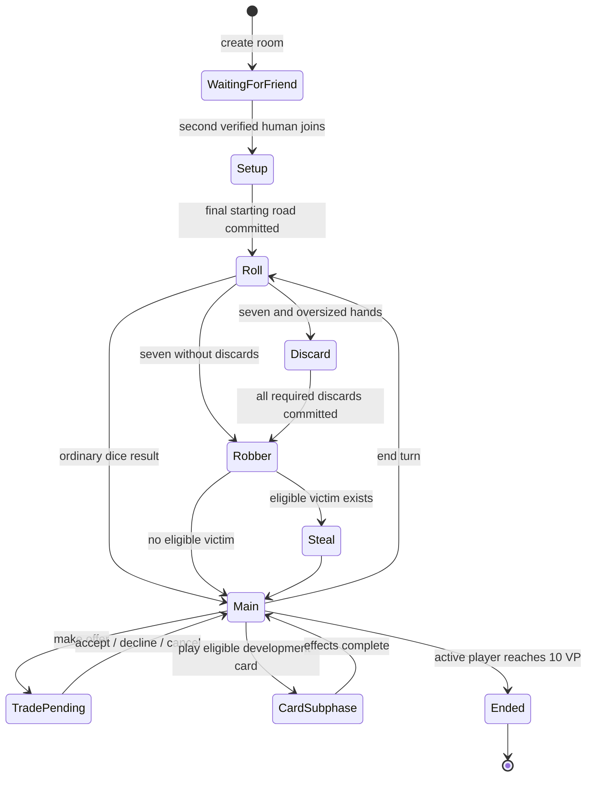

# Full Catan internet pilot

This release targets two people on separate devices and one managed bot, from initial placement to a natural 10-point victory. Existing local setup and tic-tac-toe remain separate modes. Internet Catan requires connectivity; cached UI is not a promise of offline multiplayer.

Published 2026-11-02: PWA **1.4.0**, build **5c47df960c8b**, static commit `e1a668154270ade59ac4014475a0143f02f803f3`. GitHub Pages deployment succeeded and all twenty public files (including the service worker) matched their local SHA-256 hashes. The final deterministic browser rerun passed 21 tests; the two opt-in service tests were skipped in that rerun, with the full Catan live pass recorded below. Open [Catan online](https://stefanavesand.github.io/OpenCatan/hello/#catan-online), install the update, create a room and share the invitation with the second human device. A bot is added automatically.

## Architecture

`src/game/session/catan.ts` wraps the existing pure base-game transitions and setup validator. It owns versioned snapshots, seat membership, setup progression, bounded public history and two-party player trades. It has no network, storage or UI calls. Entropy/time/IDs are injected by its authority adapter. The fixed beginner board is intentional for this pilot.

`catanView` produces a participant projection and authorized legal choices. The full snapshot/deck remain on the managed authority. Other hands are zeroed and only public card counts remain. The bot receives its own projection through the same function. Counterfactual hidden-hand tests check that its decision input and resulting choice do not change with unseen resource contents.

`bot.ts` is a stateless, bounded TypeScript heuristic. Easy and Standard use different tie/priority noise; neither has an established competitive rating. Decision randomness derives from room, revision, actor and policy version independently of dice/deck entropy. See [notices](../THIRD_PARTY_NOTICES.md) for the pinned MIT settlement-scoring adaptation. No Wasm, remote AI, model weights or original Catan art is required.

The managed Lovable project hosts `POST /api/public/catan`. Supabase stores authoritative snapshots and receipts in service-only tables. Browser credentials are anonymous, persistent principals verified at the route; local storage loss currently loses access to that principal. The room URL is an invitation for the open second human seat, not an account recovery method. The bot is not an authenticated browser and clients cannot submit its actor identity.

The PWA transport uses versioned requests, stable command UUIDs, expected revisions, a durable local outbox and cross-tab Web Locks where available. It resolves an unknown outcome using the original command before issuing a new one. Foreground polling resumes a bounded server-side bot drain; no iPad background execution or host-device secrets are required. Polling is a transport detail, not a game-engine dependency. There is no automatic human takeover.

## Gameplay and recovery

Supported actions include snake-order setup, dice/finite resource bank, roads/settlements/cities, development cards and their subphases, robber/discard/stealing, bank/port trades, two-party offers/accept/decline/cancel, longest road/largest army and active-player victory. Trade offers block the proposing player's other moves until resolved or cancelled. A bot can decline; it does not negotiate proactively. Players may reload/reconnect into their existing seats.

The transition engine is authoritative, including victory after relevant actions; the diagram summarizes the player flow. Connectivity and pending-command states are orthogonal (see SESSION_STATES.md). Offline clients stop submitting actions. Old snapshots, identities and local setup backups retain their existing storage identifiers.

## Executed evidence

The following results are local execution evidence, not device certification:

| Check | Result |
|---|---|
| Unit suite | 65 passed, including natural three/four-player games, private projection, invalid commands, atomic engine-level trading and off-turn discard decisions. |
| Seeded all-bot regression | 100/100 natural victories, alternating three/four seats and both levels; zero crashes, invariant failures or action-cap outcomes. Resource conservation checked after every action. |
| Node policy timing | 30.913 s for the complete regression; decision p95 2.726 ms, maximum 13.194 ms. This measures policy CPU in this environment, not internet latency or iPad CPU. |
| Node memory | Whole harness heap 43,017,120 bytes. This is not incremental memory per bot and does not verify the proposed 8 MiB target. |
| Deterministic PWA tests | 21 passed; two live-service tests are opt-in. Includes separate human browser contexts, managed-bot setup, offline reload and reconnect, plus existing offline/update/storage tests. The deterministic Catan backend wrapper uses the actual shared engine but is not evidence of real deployed service behavior. |
| Build | Typecheck and production build passed; existing legacy main-app bundle-size warning remains. Scoped lint passes for the new TypeScript/tests; full repository lint still fails with 371 errors and 14 warnings in pre-existing files. |
| Real managed internet game | Passed in 9.7 minutes: two independent authenticated browser contexts plus the server bot reached a natural victory after 171 human-seat commands. A real player trade, private-view assertions and offline reload/reconnect were exercised; both UIs displayed the winner. Human seats were driven automatically through authorized choices. |

Build the shared module with `node scripts/build-catan-runtime.mjs`, then run `node scripts/check-catan-bots.mjs --games=100`. The JSON report is written to `/tmp/catan-bot-regression.json`. `npm run pwa:test` runs the deterministic browser suite. The opt-in `PWA_CATAN_LIVE=1` test uses two real anonymous users and actual deployed authority, driving the human seats automatically through their own projected choices; it does not manually exercise every UI control or replace an iPad playtest.

## Remaining acceptance and operational work

Actual iPad touch, full-close/reopen, battery, two physical networks and a complete human-played game still require device validation. The local shared-iPad setup mode has no bot scheduler yet; one-human/multiple-bot and four-player internet room configuration remain follow-ups. Bot strength, incremental memory, service p95 and cost under load are unmeasured. A failed bot policy currently stops the drain; a dedicated user-visible bot error state remains open.

Pilot quotas protect normal requests, not a production abuse perimeter. Anonymous identities can be recreated and per-principal limits do not prevent distributed abuse. Expiry is logical (seven inactive days); automated deletion, receipt retention, database backups/restore exercises and billing alerts still need operational configuration. Confirm managed hosting/runtime entitlements and actual usage charges separately from Lovable editor credits.

The shared runtime is bundled identically for browser and server and its hash is checked during backend verification. Backend source runs in the linked Lovable project; a reviewed source/SQL snapshot is included in backend/catan. Keep it synchronized and reconstruct the missing initial schema migration before treating deployment as reproducible. Upstream OpenCatan code licensing remains unresolved because its README assertion lacks a repository LICENSE; original assets are not shipped by this PWA. The MIT bot notice does not grant rights to unrelated engine code or artwork.
