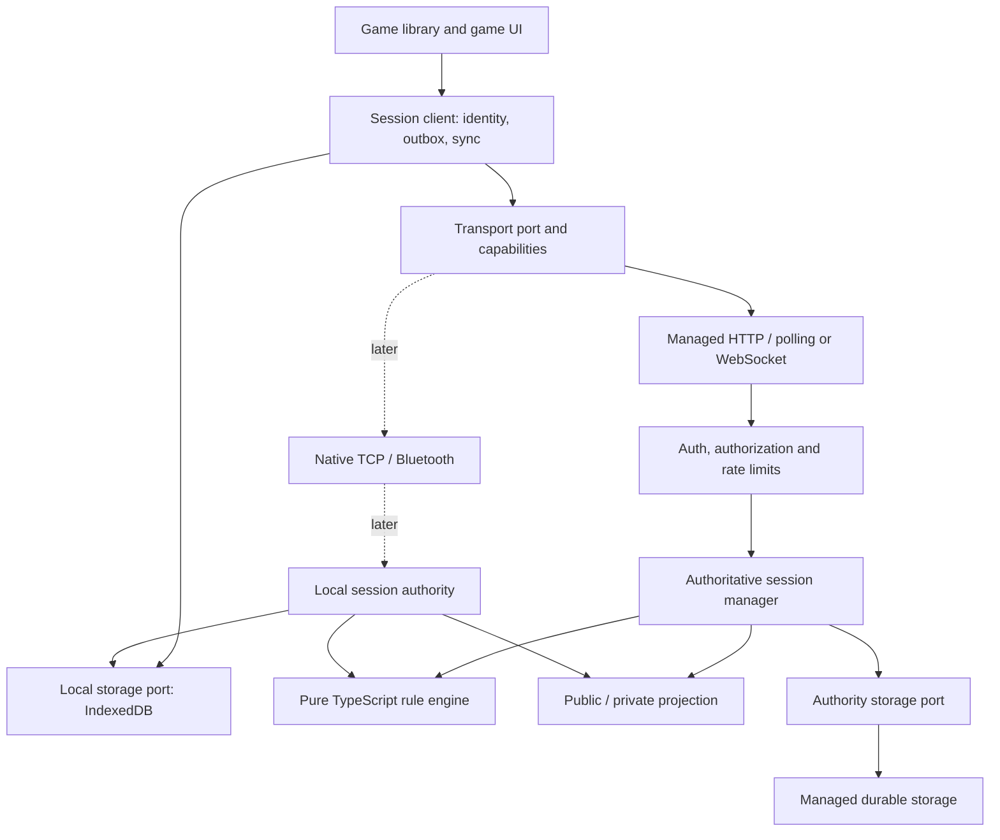
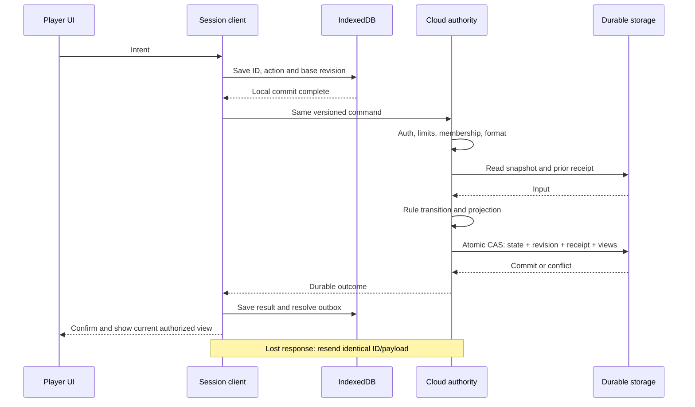
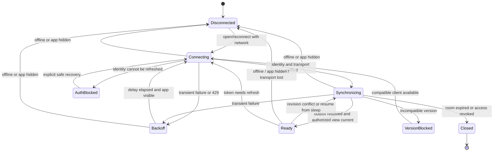
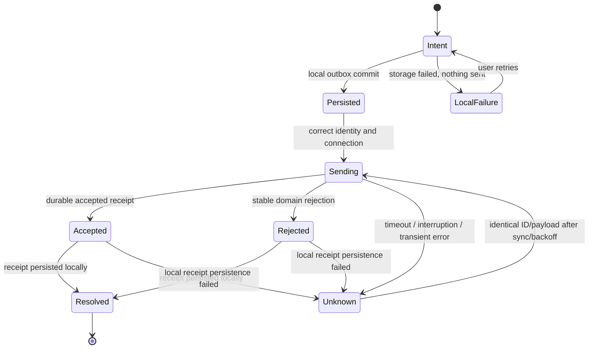
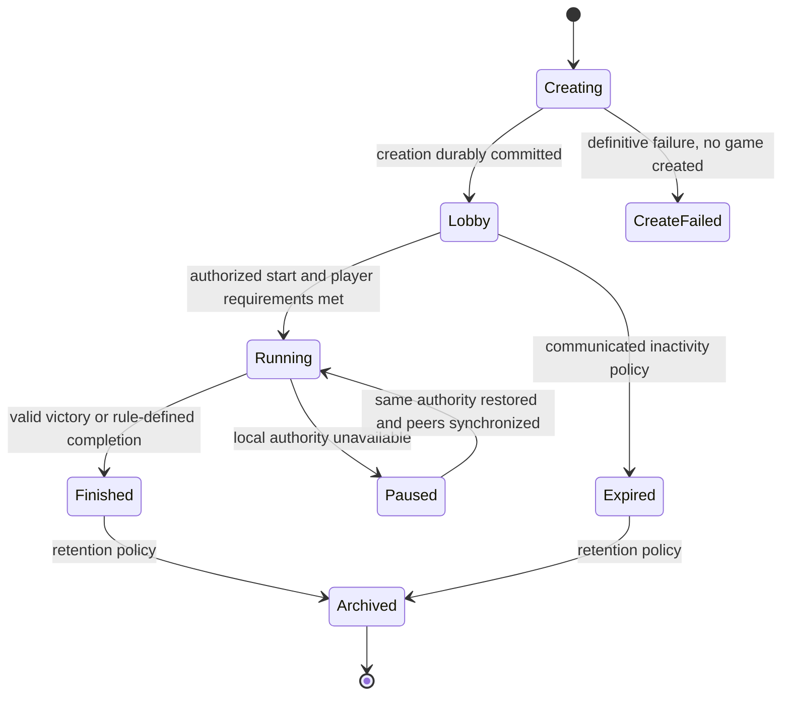

# Game Shelf / OpenCatan — High-Level Design

## Fixed responsive game viewport — 2026-11-07

The owner approved the same no-page-scroll game design for phone and iPad: compact player row, a board with bottom actions in portrait/right actions in landscape, left overlay sidebar, fitted dialogs and explicit paging for longer content. Rule/session behavior remains unchanged. See [UI architecture and verification](RESPONSIVE_UI.md). This supersedes the earlier long-page game layout.

## Account simplification — 2026-11-06

Google sign-in is required by the PWA for all gameplay, including Solo. Home shows sign-in and Help when signed out. Game dialogs use the Google profile name automatically and never ask for a player name. After a successful sign-in, Solo can create/resume games offline even with an expired internet access token. Solo saves are scoped to the account on this device; signing out hides all games, and signing back into the same account restores access. Invitation room/token survive the OAuth round trip. Anonymous signup and guest-play branches are removed from the PWA. The existing backend and its anonymous-token policy remain unchanged for now; this is a product/code simplification, not a new server authorization boundary. Historical anonymous accounts/unowned saves are not migrated. No server data is deleted. Account changes remain fenced against pending moves. Cross-device game discovery, Solo synchronization, other OAuth providers and device handoff verification remain separate work.


Version 1.3 · 2026-11-04 · Current MVP boundary addendum; older E1/E2 design retained as historical target context.
Requirements baseline: [PRD 3.11](../PRD.md). The PWA and OpenCatan preview are separate implementations to be unified incrementally. Version 1.1 translates the 1.0 baseline into English; it does not select a new provider or change the implementation scope.

## Accepted MVP boundaries — 2026-11-04

Implements the product constraints MVP-L01–05 in the [PRD](../PRD.md) and [MVP requirements](MVP_REQUIREMENTS.md), which take precedence over older cloud-authority/managed-bot assumptions below. UX scope and release gates MVP-R01–06 are now approved in the linked requirements; concrete device/operating values and verification remain open.

- The current PWA runs the deterministic rules and retains full state; the service supplies authenticated identity, membership and ordered relay history. Trusted participants may inspect secrets; bot observations and ordinary UI remain seat-specific.
- Anonymous credentials and game checkpoints persist in browser storage. No recoverable account, cross-device identity restoration or local-save recovery after deletion is promised in MVP.
- The relay enforces seven-day access expiry. Session/UI handling must stop clearly on expiry; this does not specify deletion or backups. Retention/cleanup and budget/ownership remain open operational work.
- The creator PWA schedules ordinary bot commands while active. Closing/suspension may pause progress; reopening synchronizes saved/pending commands before scheduling further work. There is no automatic coordinator transfer or reliance on iOS background execution. This is an accepted MVP limitation, not a missing server-rule feature.
- iPad is the certification target; responsive phone design is required now, with full phone/native certification deferred. The exact reference devices/OS and acceptance results remain to be recorded.

## Approved release verification — 2026-11-04

Current update coordination uses a shared Web Lock for main-session mutations and an exclusive activation/install-audit gate. The worker audits versioned save metadata before installation and persists an engine fence to prevent old-engine game creation while an incompatible candidate waits. This also addresses browser automatic activation when the final window closes. Stale windows check the active worker version before writes; update-state contains only release metadata. See [protocol and executable limits](PWA_UPDATE_VALIDATION.md).

Current PWA update/cache protocol and its verified limits are recorded in [PWA update verification](PWA_UPDATE_VALIDATION.md). It stages verified downloads, includes the worker template in cache identity, revalidates before activation and supports retryable cache repair. The current implementation also fences cooperating main-PWA windows, audits saves before installation and protects against last-window automatic activation; the linked evidence distinguishes those scenarios from unverified iOS/process-termination behavior.

Follow MVP-R01–06 in the [current requirements](MVP_REQUIREMENTS.md). Keep automated production-session evidence separate from physical iPad acceptance, independent rule expectations and operational verification. Storage/update work must provide a safe abandon path while preserving unresolved-command semantics. Bot performance measurement belongs on the declared reference iPad; the paced live integration run is not a latency benchmark. Record concrete retention, budget, ownership and rollback choices before release. The completed [real-relay game](EMULATED_MULTIPLAYER.md) is existing evidence, not a reason to repeat the entire run for documentation-only changes. No new server rule engine, account recovery or automatic coordinator transfer is implied.

## New relay mode: approved direction (2026-11-03)

The owner approved [the identity and relay contract](SESSION_API_SPEC.md) for a new trusted-friend mode. PWAs share a pinned deterministic engine and full game state; participants can technically inspect secrets, while the normal UI and bot observations remain seat-specific. The managed service verifies identities, controls private channel membership, orders messages and temporarily retains history. It does not run rules or bots. Reproducible divergence stops play with an error; automatic recovery is deferred. The PWA requires Google sign-in; Microsoft and account linking remain AUTH-01 follow-ups. Backend anonymous-token acceptance is unchanged.

This approved direction applies to new relay-mode work. Existing managed Catan/tic-tac-toe sessions, their server authority, private projections, identities and pending intents remain unchanged. The older architecture below describes that existing mode and broader roadmap. Implementation, privacy/expiry disclosure and release verification for the new mode remain separate gates.

## Solo extension (2026-11-02)

PRD 3.6 / M-17 adds optional solo internet rooms to the existing managed implementation; the older target design below remains broader roadmap context. See [solo integration](SOLO_INTEGRATION.md). Creation includes an explicit solo mode in its durable intent and initializes the complete three-seat session atomically. Friends mode preserves the legacy request hash. The authority selects eligible actors from the current snapshot, intersects them with declared bot seats and commits each bot decision under revision CAS and a deterministic room/revision/actor receipt. Each policy receives only its own authorized projection. Bounded work continues on later view requests. Solo rooms have no guest admission; human identity is never assigned to a bot seat. API/engine and client-storage versions remain compatible.

## 1. Decisions and boundaries

| Decision | Meaning / requirements |
|---|---|
| D-01: one rule implementation | Pure TypeScript engine with injected time/randomness, no UI/network/storage. UI may show legal choices; authority validates. ARC-01, UX-08. |
| D-02: authoritative session | Cloud authority for internet games; local authority for offline/pass-and-play and later LAN/native. Authority holds full internal state. No automatic host migration. DATA-02, SEC-06. |
| D-03: durable commit before acceptance | Atomically write internal state, revision, receipt and materialized player views. Network may deliver repeatedly; apply each accepted command ID at most once. DATA-01/02. |
| D-04: separate lifecycles | Connection, command and game have independent states. Connected is not synchronized; timeout is not rejection. UX-04/05, NFR-01. |
| D-05: replaceable adapters | Explicit transport/storage contracts. Keep the working PartyKit preview and Lovable prototype while moving one flow at a time. ARC-02, DATA-04. |
| D-06: choose provider through an experiment | Keep Lovable Cloud for working tic-tac-toe. Before Catan, choose a managed runtime supporting the shared TypeScript engine and atomic persistence. This document alone does not authorize a migration. OPS-01. |

Players, cloud operator and local host have different trust levels. A trusted authority can read all internal cards. This design prevents clients from receiving opponents' secrets, but does not cryptographically protect against the authority. Two people sharing one device cannot be guaranteed private hands against someone controlling that device. Offline Catan with private hands therefore needs multiple devices or an explicitly accepted pass-and-play privacy model. Tic-tac-toe has no secret hands.

## 2. Components and dependencies



Arrows show calls/dependencies. UI imports public session-client types, not provider clients or internal authority state. Authority calls the engine and injected storage/randomness services; engine does not import those services. A Redux adapter may remain during migration. An HTTP endpoint adapts the session; it is not the rule engine.

| Component | Responsibility | Must not |
|---|---|---|
| Game UI | Render recipient view, collect intent, show pending/errors and touch controls. | Generate final dice outcomes or mutate authoritative state. |
| Rule engine | `validate/transition(state, actor, action, context)`, rule invariants and domain events. | Perform I/O or use its own wall clock/random source. |
| Session client | Persist intent, resend the same command, handle revisions/identity/reconnection. | Treat timeout as rejection or silently replace identity. |
| Session authority | Permissions, dedup, engine validation, revision and atomic commit. | Acknowledge durable success before commit. |
| Projection | Explicitly allowed player fields and log events. | Serialize full state and rely on UI to hide secrets. |
| Transport | Deliver bytes/envelopes, status and actual limitations. | Implement game rules or promise exactly-once delivery. |
| Storage | Transactions, schemas, snapshots/receipts, outbox and retention. | Decide move legality. |

Suggested package boundaries are logical, not an immediate monorepo requirement: `domain/`, `session/`, `ports/`, `adapters/`, `ui/`. Existing `src/game/engine/base` and `src/session` are starting points, but state types need to be detached from Redux and setup logic extracted. Import boundaries should be automatically enforceable.

## 3. Identities and data model

Keep distinct: `principalId` (verified cloud subject or locally paired subject), `playerId` (session seat), `sessionId` (game), `roomId` (invitation/lobby resource). Authority owns the seat mapping. A new sign-in is not automatically the same player. Future friend relationships connect account identities, not game seats, and never grant session access by themselves.

| Object | Content / owner |
|---|---|
| SessionMetadata | Game type, rule version, participants/seats, settings, lifecycle, authority ID and fixed authority epoch. No private hand. |
| AuthoritySnapshot | Schema/rule versions, session, revision, full internal state, phase, deck, internal randomness/effect information and latest durable commit. Authority/authorized recovery only. |
| PlayerView | Protocol/view version, session, authority epoch, revision, public fields and this player's private fields. Never a source for full recovery. |
| CommandIntent | Stable client ID, session, protocol version, expected revision, action and local pending state. Persist before sending. |
| CommandReceipt | Key `(sessionId, playerId, commandId)`, canonical payload hash, outcome/error, decision revision and rule/protocol versions. No full snapshot or opponents' secrets. |
| IdentityBinding | Verified subject to seat, validity and future recovery mechanism. A token is not a public playerId. |

Distinguish protocol version, save schema, rule version and app/build version. Unsupported versions fail explicitly and preserve data. A running game is pinned to its rule version; an app update must not silently change rules mid-game.

Authority's injected CSPRNG generates randomness, passed explicitly into the engine. Outcomes and required continuation information are stored in the move's commit. Never give clients future deck order, seeds or another player's private recovery data. Failed CAS means the move was not accepted; after successful commit, its receipt determines every retry's result.

## 4. Protocol and transport port

Logical contract, not a new parallel implementation in this documentation stage:

```typescript
interface CommandEnvelope {
  protocolVersion: number;
  sessionId: string;
  authorityEpoch: number;
  commandId: string;
  expectedRevision: number;
  action: { type: string; payload: unknown };
}
// Actor comes from a verified connection/token, never the envelope.
interface TransportCapabilities {
  requiresInternet: boolean;
  updateMode: 'polling' | 'push';
  ordering: 'none' | 'perConnection';
  delivery: 'bestEffort' | 'connectedOnly';
  targetedDelivery: boolean;
  maxPayloadBytes: number;
  discovery: 'invitation' | 'local' | 'none';
  backgroundProgress: false;
}
```

Operations: `connect(credentials, invitation?)`, `submit(command)`, `readView(sessionId, knownRevision?)`, `readReceipt(commandId)`, `subscribe(handler)` and `close()`. HTTP may implement subscription through foreground polling; native may provide targeted push. Session client owns retry/outbox/sync. Both sides enforce payload/version limits; server always enforces authentication and quotas.

Responses include version, session, authority epoch, command ID where relevant, outcome, machine-readable error, revision and optionally an authorized view/retry time. Reject wrong session/epoch and ignore older views. Full views may jump revisions; future deltas require an exact base revision or trigger full sync. Sequence numbers are session revisions, not transport packet numbers.

Bind the payload hash to canonical content including action, version, epoch and expected revision; byte/field order must not change meaning. Same key with different content returns `COMMAND_ID_CONFLICT`. Dedup precedes comparison with the current revision, so a previously accepted command is not rejected on retry.

Retain receipts for the full resumable session lifetime plus the retry window. After cleanup, an expiry marker or closed session must reject old commands; a missing receipt must not allow an old accepted ID to execute again. Exact retention is a release decision (§11).

## 5. Command flow and atomic persistence



Trusted commit operation repeats membership/version/dedup checks within the transaction, checks base revision and writes everything or nothing. Unique receipt keys and CAS/serialization prevent concurrent duplicate moves. Rule rejection also has a stable, recoverable decision result; transient auth/overload/transport errors are not domain decisions and do not finalize the command. After revision conflict, the user may choose a new move with a new ID after sync.

If commit succeeds but notification fails, durable state/views remain available to polling/reconnect. Future push uses a transactional notification outbox or equivalent to prevent gaps; notification itself is never the durability receipt.

Local authority uses the same session algorithm and one IndexedDB transaction across internal state, revision, receipts and views. Compute the transition first, then compare base revision and write atomically. Avoid arbitrary async I/O inside IndexedDB transactions. Client outbox and authority receipts serve different purposes even on one device.

### Managed TypeScript execution: experiment before provider choice

First candidate: a Lovable Cloud/Supabase server function running the shared engine, with a privileged atomic database operation for **persistence**, not duplicated game rules. Server function reads full internal state server-side and CAS-commits state/receipt/player views together. Clients cannot invoke internal commit, write state or read secret tables. If function/database permissions, transactions, versioning or cost are unsuitable, choose another managed adapter.

Second candidate: TypeScript on Cloudflare Workers/PartyServer with Durable Objects, one object coordinating a game and durable storage behind the same port. An in-memory instance does not replace durable commit or concurrency protection. New production must not assume the former PartyKit hosting platform; verify current deployment documentation when choosing.

**Decision ADR-01:** demonstrate tic-tac-toe using exactly the same engine online/locally, concurrency, commit/crash/retry, private dummy data and measured cost. Then select a provider. Existing SQL-authoritative tic-tac-toe continues until its replacement passes. Neither candidate has been verified with OpenCatan at this stage.

## 6. State charts

These diagrams specify the target. Transitions below identify key guards/effects; implementations need explicit reducers/state machines and tests, not diagrams alone.

### 6.1 Participant connection



- Only `Ready` allows new game commands; connection/version blocking never deletes the outbox.
- On return, verify identity, resolve pending intent, then fetch current view. An old receipt must not roll back a newer view.
- `Disconnected` describes the client's update state; cloud play may continue for others. Hidden apps stop polling. An in-flight request may still commit; durable outbox enables recovery.
- Transient token refresh goes through `Connecting`; unrecoverable identity goes to `AuthBlocked`. Never automatically sign up a replacement identity.

### 6.2 One command



`Persisted`/`Unknown` survive process death through the outbox; after restart, treat sending as unknown too. Retry exact stored content. Never modify/reissue a rejected move as a new command automatically. New intent gets a new ID. A version/auth failure blocks sending but is not proof that an earlier request never committed.

### 6.3 Game lifecycle



Unknown creation outcome remains pending/resolving under the command chart; never create a replacement game with a new ID automatically. A cloud process restart restores the same `Running` game from storage; one disconnected client does not pause others. Do not automatically delete an active game because one player is absent. Decide explicit abandonment/deletion/retention policy before automation.

The engine additionally has game-specific phases: Catan setup → roll → optional discard/robber/steal → main phase → next turn/end. Development cards may create subphases, e.g. pre-roll Knight returns to roll. Produce the detailed rule state chart when extracting setup, covering every command; the existing `GamePhase` type is not a verified specification by itself.

## 7. Error model and user behavior

| Code class | Retry / transition | UI and data implications |
|---|---|---|
| `NETWORK_UNAVAILABLE`, `TIMEOUT`, transient `SERVER_UNAVAILABLE` | `Unknown`/`Backoff`; same ID | Explain outcome is being checked; retain intent. No optimistic durable acknowledgment. |
| `RATE_LIMITED` | Honor `Retry-After` and jitter | Retain intent, explain delay, stop aggressive polling. |
| `AUTH_EXPIRED` | One coordinated token refresh | Keep seat/outbox; resume same intent after verification. |
| `IDENTITY_UNRECOVERABLE`, `FORBIDDEN` | Block; no endless retry | Explain access problem; offer controlled recovery or a new separate game. |
| `REVISION_CONFLICT` | Stable rejection, then sync | Show current view; a new move needs user choice/new ID. |
| `ILLEGAL_ACTION`, `ROOM_FULL` | Stable rejection | Understandable reason without secret information. |
| `COMMAND_ID_CONFLICT` | Block invalid intent | Retain diagnostics without secret payload; never execute changed content. |
| `LOCAL_STORAGE_FAILURE` | Stop new sending / retain uncertain outbox | Distinguish never-sent moves from previously sent outcomes requiring resolution. |
| `AUTHORITY_STORAGE_FAILURE` | No success before commit | Transient retry with same ID; receipt lookup resolves uncertain commit. |
| `UNSUPPORTED_VERSION`, `CORRUPT_SAVE` | Block affected session | Preserve original data; offer compatible version or safe recovery. |
| `SESSION_EXPIRED`, `SESSION_DELETED` | Terminal `Closed` | No resend or new session under the old ID. Explain lack of recovery. |

E1 retry policy: exponential delay with jitter and bounded concurrency, at most one sending operation per session client, no background retry loops. Numeric intervals/rate limits are measured configuration before release; the original prototype's fixed five-second polling/generic errors did not implement the full policy. Translate HTTP/transport failures into stable domain-neutral codes; no raw database errors/tokens in UI/logs.

## 8. Security design and threat model

| Threat / trust boundary | Control | Verification |
|---|---|---|
| Forged player ID, action or future revision | Verified subject, server-side seat binding, engine validation, CAS. | T-03/04/07. |
| Leaked invitation / unauthorized read or subscription | Invitation enables controlled join only; membership checked for every API/view/subscription. Full rooms protect seats. Future link expiry/rotation is ADR-02. | T-03/06. |
| Replay, duplicates, changed payload | Unique ID, content hash, stable receipt and defined retention/expiry. | T-04/10. |
| Secret hands leak through state, error, logs or realtime | Server-only full state; allowlisted separate recipient projections. No private fields in public notifications. | T-06 with actual network inspection. |
| Script injection steals browser tokens | Text rendering, no unsafe HTML, CSP, no external runtime scripts, dependency review; never log/export tokens. IndexedDB does not remove XSS risk. Native credentials later use secure platform storage. | T-08 + security review. |
| Mass creation, guessing, large payload, reconnect storm | Gateway/session limits before expensive work, identity/IP/room quotas, payload limits, backoff and cost alerts. | T-08 in an isolated environment. |
| Misconfigured database / API bypass | RLS reads, deny client mutations, server-only internal commit with least privilege. Test direct database/API/subscription paths too. | T-06/08. |
| Malicious local host / cloud operator | Document trusted authority. No promise to protect secrets from its full internal access. No automatic migration. | Review + T-10. |

Room IDs should be hard to guess. Friendly short codes need separately rate-limited lookup, not weaker read permissions. Prototype UUIDs are not completed join-abuse controls. Public client keys are allowed; privileged keys remain in server secrets and follow a rotation procedure.

Separate rate-limit categories: anonymous signup, create, join, read/poll, submit, subscriptions and payload. Provider defaults are not product policy. Retries/dedup still cost resources and need limits. Test normal shared-NAT use; IP alone is not identity. Before pilot, ADR-03 defines concrete values, response codes/Retry-After, hard quotas and cost alerts. Never describe an alert as a guaranteed spending cap.

## 9. Offline, updates and recovery

Service worker caches a build-specific app shell and required resources. “Ready for offline” requires verified complete download. Installing a candidate must not destroy the active version; activation waits for local writes and leaves the outbox durable. User controls update activation.

Local play: IndexedDB adapter with versioned state/receipts/outbox, transactional CAS and handling of quota/denied persistence. Cloud play: client cache is only an authorized view, never a replacement authority. Without network, the UI may show a stored authorized view marked stale but cannot accept new internet moves. The prototype currently restores its view only when network returns.

Browser storage may be cleared despite persistence permission; local backup therefore has its own format. A full authority backup contains secrets and must not be exported as a normal player copy. Cloud players export only permitted public/own information under an explicit policy. Sharing a full local-host backup may reveal all cards and requires a warning/permission boundary.

Distinct recovery failures:

- Client/authority process dies: restore latest committed snapshot/receipts; ordinary process restart must not lose durably acknowledged moves.
- Local host device/browser storage is lost: requires authorized backup or the game may be lost. Other players' redacted views are insufficient.
- Provider loses storage: requires backup/PITR and tested restore; decide RPO/RTO separately. Transport security/DB transactions are not disaster recovery.
- Incompatible update: preserve data/rule version, support the old session or stop safely. Frontend rollback alone cannot roll back a database format.

## 10. Operations and observability

Static PWA may remain on GitHub Pages; backend is managed. Separate test/production, version migrations and verify old installed clients against new backend. Deployment must not require updating every iPad simultaneously.

Measure p50/p95 intent-to-durable-receipt time, opponent visibility latency, reconnect/sync failures, receipt retries, rejection codes, auth/rate/storage failures and cost per active room/game-hour. Report network latency/local-write time with PRD targets. Use bounded correlation identifiers; never log tokens, card payloads or internal snapshots. Retention covers logs/backups too.

Do not run large load tests against working production. Use an isolated environment/budget for T-08. Before a wider pilot, decide cleanup for old rooms/anonymous identities, completed games, receipts and local copies. Coordinate deletion with active games/retry contracts; communicate access expiry. Define operational owner, incident/rollback procedures and provider-outage messaging.

## 11. Gaps, decisions and incremental implementation

### Existing implementation versus target

| Existing | Gap to this HLD |
|---|---|
| Hash-verified PWA cache, manual update activation and local IndexedDB tic-tac-toe. | Shared session contracts, save formats and migrations for more games. |
| Online PWA adapter, anonymous auth, localStorage outbox, foreground polling. | Common lifecycle/error handling, IndexedDB outbox, strict format validation and identity-loss recovery. First client policy slice is noted below. |
| Lovable SQL-authoritative tic-tac-toe with durable state/dedup. | Same engine online/locally, payload binding/stable rejections, receipt retention and server-crash recovery tests. |
| OpenCatan `src/session`, PartyKit adapter and partially extracted engine. | Independent state/setup, full snapshot, durable receipts, complete private views, trading and natural full games. |
| Original code/assets and archived PRD. | Licensing/rights, distribution permission, quality debt and expansion specifications. |

### Open decisions before release gates

| Decision | Evidence / gate |
|---|---|
| ADR-01 runtime | Same TypeScript engine, atomic commit, concurrency/crash and cost in reference game. Before moving OpenCatan online. |
| ADR-02 identity/invitations | Token loss, Safari/PWA storage isolation, seat recovery without secrets leaking, link expiry. Before E1 pilot. |
| ADR-03 operational limits | Concrete quotas/payload limits, budgets, retention, dedup window, backup/RPO/RTO and responsibility. Before E1 pilot. |
| ADR-04 rule reference/rights | Scoped base rules, variants, licensing evidence and replacement assets. Before E2 distribution. |

### Small implementation steps

1. Implement shared contracts and pure lifecycle transitions in tic-tac-toe without switching provider. Add version failures, stable error codes and payload binding. T-03/04/09.
2. Move online outbox behind storage port/IndexedDB; test crash before/after commit, auth/storage errors and update compatibility. Preserve local saves. T-01/02/04.
3. Run ADR-01 with the same engine locally and in a managed authority. Test private dummy data before real cards. Choose based on execution, not documentation assumptions. T-04/06/08.
4. Complete ADR-02/03, limits and observability. Verify sleep, two physical networks and compatible updates; close E1.
5. Move OpenCatan setup/state, then one base-game flow at a time. Implement player trading and audited projections. Natural 3-/4-player games and rights review close E2.
6. Capacitor/LAN and then Bluetooth are separate E3 experiments reusing protocol/authority/storage requirements. Do not introduce automatic migration as a side effect.

Each step should be reviewable, testable and releasable without a large rewrite. [PRD §8](../PRD.md#8-verification-plan-and-release-gates) provides the traceability matrix. Actual execution status belongs in verification reports. This document defines design/gaps, not new passing tests.

### Implementation note: first slice

PWA 1.2.1 implements a first pure client policy for connection/command outcomes, failure codes and retry. See [SESSION_STATES.md](SESSION_STATES.md) for verification/gaps. User confirmed the version works. Contracts, backend payload binding and shared rule execution remain incomplete; charts above are still target specifications.

### Bot requirements baseline

[Bot requirements](BOT_REQUIREMENTS.md) introduce planned BOT-01–18 and B1/B2/B3 gates. A future bot policy consumes only an authorized immutable player observation and legal choices; the trusted session authority schedules it and submits ordinary commands. Local setup runs offline on the local authority; internet bots run with the managed authority. Durable intent recovery, bounded computation, cancellation and policy/version compatibility must be designed before implementation. Source choice and execution details remain open; no bot runtime is implemented by this document change.

### Implementation note: full Catan internet pilot

[CATAN_FULL_GAME.md](CATAN_FULL_GAME.md) records the next implementation slice: the same bundled TypeScript session/decision engine runs in the PWA test harness and managed authority; server-only snapshots/receipts, authorized choices and two-human/one-bot rooms replace duplicated online rules for this Catan flow. The managed adapter currently uses a TanStack HTTP route with Supabase rather than a Supabase Edge Function. Review artifacts and their deployment limitations are in [backend/catan](https://github.com/stefanavesand/OpenCatan/blob/5418f60/backend/catan/README.md). This establishes an executed ADR-01 direction; it does not close E1/E2, identity recovery, operational or device gates. The separate legacy tic-tac-toe backend remains unchanged.

### Responsive design direction (2026-11-02)

The MVP product baseline is agreed in [MVP_REQUIREMENTS.md](MVP_REQUIREMENTS.md). iPad portrait/landscape is the first release target; compact phone layouts must be designed now for later mobile support. Keep viewport, safe areas, board navigation and hand/action presentation inside the UI boundary. Shared rules, private projections, session recovery and transport contracts must remain independent of screen size. Full phone/device certification and Capacitor packaging retain their separate later gates. Visual design and operational acceptance details remain under review.

## Browser game history and resume (2026-11-03)

M-18/19 keep API/engine/storage versions unchanged. The IndexedDB adapter enumerates existing authorized view records for the saved principal and projects summaries for home; optional lastSeenAt metadata sorts new records without a schema migration. Other principals' cached views are excluded. A selected old game resumes via an authenticated view request under the existing session lock, without claiming a guest seat. Only success caches the recipient view and changes current room; network denial/mismatched room keeps current state, and unresolved mutations block switching. This is browser-local discovery, not server listing or identity recovery. Product navigation uses plain game terms and board targets; style identifiers and historical design artifacts may retain old internal names for compatibility.

## Trade presentation (2026-11-03)

M-20 adds a UI-only draft bound to room and revision, separate from submitted session commands. play/trade.js derives validation, retained/projected own counts and bank bundles; it neither applies game transitions nor calls a provider. Player requests use only public opponent card totals. Bank/port actions are selected directly from the authenticated view’s legal choices, retaining the exact rate/action. Draft changes do not mutate the authorized view; review copies the immutable offer/action before existing outbox/CAS submission. Polls retain same-revision drafts; changed revisions and offline/pending state disable stale modal controls. No protocol, engine, storage schema or backend migration is required.

## Replicated Catan engine slice (2026-11-03)

[The new engine](CATAN_ENGINE.md) runs shared rules 2.0.0 in the PWA with a pinned deterministic PRNG continuation, logical revision time and counter-based entity IDs. This is the selected concrete effect representation for the timer-free trusted-friend game; a separate per-action randomness tape/coordinator roundtrip is unnecessary. Human actions bind the displayed game revision/hash. Bot decisions run only on the creator, from the bot's seat projection, and are replicated as ordinary commands. The separate developer interface verifies the boundary; main UI, app-shell updates and physical acceptance remain open. Old-game migration is not a requirement per owner clarification.

## Google identity adapter (2026-11-06)

An original PWA adapter uses the existing Supabase OAuth authorize endpoint and PKCE token exchange, with a random verifier persisted on the initiating origin. No Google secret or new auth server enters the app. Callback codes are scrubbed from the current URL and accepted only with a recent local flow; the existing principal must still match the flow's starting principal. The PWA no longer creates anonymous accounts. The owner waived historical anonymous-game migration. Authentication changes run under the existing exclusive lifecycle gate, rejecting unresolved deliveries; gameplay, bot scheduling and rules stay independent. Local Solo records remain local and are keyed by account. Account switching and sign-out preserve saved game records; the active online index is selected by the authenticated subject.
