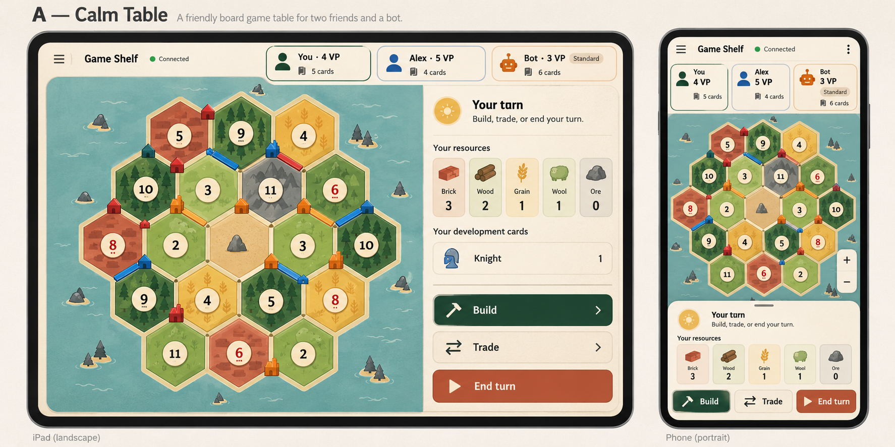
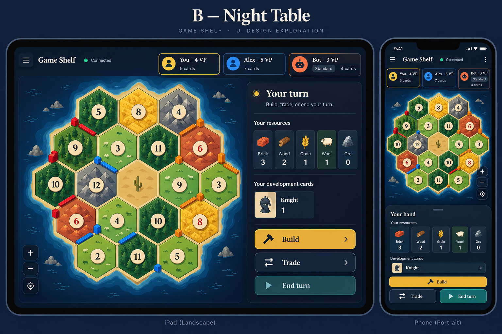
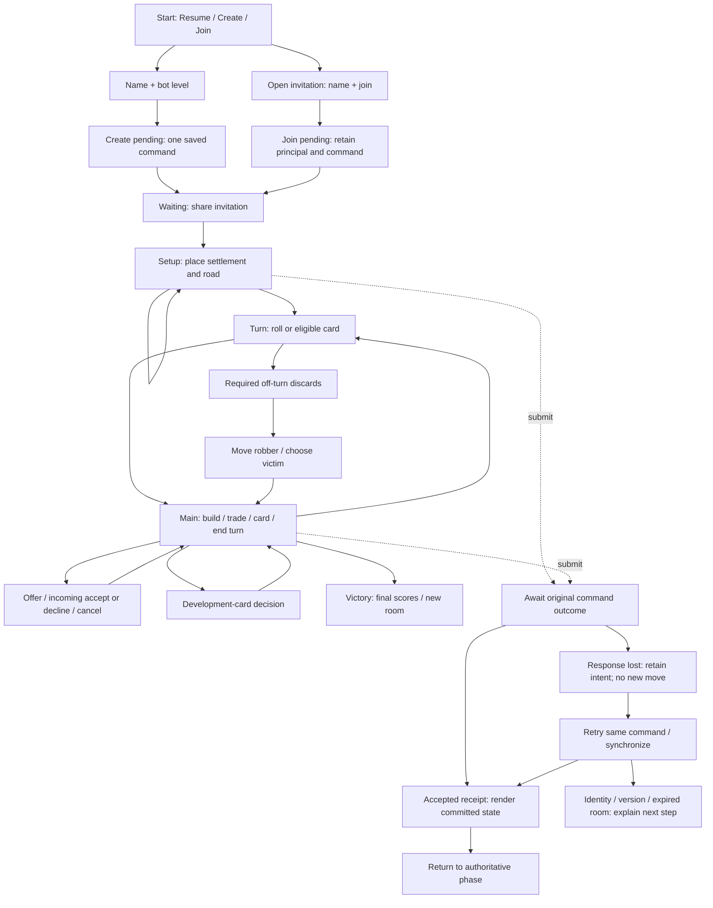

# Private MVP — visual concepts and low-fi journey

2026-11-02. Product baseline: [MVP requirements](../MVP_REQUIREMENTS.md). This document supplies the first visual options and annotated journey for UX-01. The images are generated original concept explorations, not screenshots of implemented UI, approved final designs or executable prototypes. The user selected **A — Calm Table** on 2026-11-02. That selection establishes the visual direction, not final component/prototype approval. Production code, hosting and installed apps are unchanged.

## Two visual directions

Both options show a landscape iPad and a compact portrait phone, with the same intended game functions. The board is dominant, own cards/actions are adjacent or in a bottom tray, and create/join controls are absent from active play. Phone support is designed in now; physical phone certification remains a later gate.

### A — Calm Table

Warm ivory surfaces, pine-green primary action, terracotta accent and restrained terrain illustrations on a seafoam board surround. Friendly tabletop character with sans-serif text. Recommended starting direction for the MVP; daylight legibility is a design intent to test, not a measured accessibility result.

### B — Night Table

Ink/slate surfaces, ivory labels, amber primary action and teal secondary action, with stronger geometric terrain contrast. A more compact evening-game character. Choosing this option does not imply implementing a light/dark theme system; A — Calm Table is selected for the first MVP; B is retained as exploration only.

### Review boundaries

The images communicate layout, palette and hierarchy. They are not canonical game snapshots: resource-count labels, exact board/piece arrangements, player colors and geometry must be replaced with engine-valid data and verified in the next prototype. Contrast ratios, actual CSS touch sizes, text scaling, focus, safe areas and motion are not proven by a rendered image. Treat the illustrated artwork as exploratory; establish a maintainable original asset set and provenance before shipping it. Use the engine's canonical resource names consistently in final UI.

Neither image alone covers iPad portrait, special phases or failure states. D-03–07 remain open. The first next step with the selected Calm Table direction is a responsive clickable prototype of the journey below, using valid sample state and explicit asynchronous states.

## Annotated low-fi journey

Connectivity is an independent layer, not a rule-engine phase. Every submission path, including join, trade, discard and special cards, uses the same pending/unknown/receipt semantics; arrows above illustrate that common layer rather than enumerate every link. Seven without required discards goes directly to robber decisions; cards can also start allowed subphases before rolling. The engine, not diagram navigation, determines legal phase transitions and victory after each relevant action.

| Step | Visible information / interaction | Waiting, failure and recovery | Requirements |
|---|---|---|---|
| Start/resume | Catan/resume primary; experiments separate. Existing room is resumable by saved identity. | Offline shell explains internet-game pause; missing identity never creates a replacement seat silently. Existing-room switch is explicit. | M-01/06/10 |
| Create | Name, Easy/Standard, one Create action. | Disable repeat submit while intent is pending; auth/storage/429 error has a distinct next step. | M-02/05/08/13 |
| Invite/lobby | Share link, human seat occupancy, bot level. First valid guest claims the empty human seat. | Same-principal rejoin preserves seat; full/expired/malformed room is explicit. No extra host-approval flow. | M-02/10 |
| Setup | Acting seat, round/order, settlement or road instruction, legal targets. Own hand receives second-settlement resources only. | Friend/bot turn is visibly waiting. Preview differs from saved piece; double submission is blocked. | M-03/04/05/08/14 |
| Ordinary turn | Dice result/phase, own hand, costs, public player counts/VP, Build/Trade/End turn. Room details in a sheet. | Other hands remain secret; no action appears committed from local selection alone. Preserve board readability while waiting. | M-03/04/05/07 |
| Build | Select piece, inspect cost, choose legal location, preview, confirm or cancel. | Authority rejection refreshes legal choices and explains the outcome; it never commits a substitute location. | M-03/04/05/14 |
| Trade | Specify both bundles/recipient; review then offer. Recipient sees exact terms and accept/decline; proposer can cancel. | Offered terms are bound to the offer ID. Stale/withdrawn/insufficient-hand rejection cannot accept a different offer. | M-05/07/09 |
| Discard/robber | Off-turn prompt says exact discard count; selectable owned quantities. Robber/victim use distinct legal choices. | Do not assume the currently active player is the only eligible actor. Wait for required human decisions; never take over their seat. | M-03/04/07/08 |
| Development card | Select an eligible own card, then its explicit resource/road/robber choices. Show what remains to choose. | Card bought this turn/unavailable effect is explained; no opponent card identities exposed. | M-03/04/07 |
| Recovery | Offline, synchronizing, pending outcome, rate cooldown, bot error and permanent identity/version/expiry failures differ. | Unknown command outcome retries the original ID. No new move is enabled until resolved. Clear next steps; no endless spinner or blind reconnect loop. | M-05/06/08/10/13 |
| Victory | All participants receive the same winner/final scores; new-room action is deliberate. | Lost winning acknowledgment resolves its original receipt; reopening does not start a new game. | M-03/05/15 |

## Selection, commitment and responsive behavior

Proposed common pattern: choose action → choose legal target/quantities → inspect preview → Confirm or Cancel → await receipt → show committed outcome. Apply it to setup and later piece placement consistently. Simple roll/end-turn controls can be direct actions with an immediate pending state; do not add a confirmation dialog to every turn. Final interaction agreement follows prototype walkthrough, including accidental-tap checks.

iPad landscape keeps board and own-hand/action panel visible together; portrait puts a compact hand/action tray below the board. Phones use reflowed player summaries, readable board overview and expandable hand/detail sheets, with deliberate board pan/zoom if needed. Preserve at least 44 CSS px controls, safe areas and primary-action access. Avoid page-wide horizontal overflow and retain visible off-turn/recovery prompts when sheets are open. Virtual keyboard behavior belongs to lobby/trade testing.

Acceptance and accessibility must be tested with actual layouts and people. This concept work is not evidence for M-11 rights clearance, M-14 accessibility compliance or M-15 device acceptance. Operational rules remain as documented in the MVP decision register.

## Status and next design work

- D-01: initial annotated low-fi journey drafted here; ready for review, not approved.
- D-02: two visual options produced; A — Calm Table selected by the product owner.
- D-03–05: first responsive implemented design, component/state draft and clickable scenarios are now available in [CLICKABLE_PROTOTYPE.md](CLICKABLE_PROTOTYPE.md). Further state coverage/refinement remains open.
- D-06/07: iPad walkthrough and final design agreement remain open.
- No new paid backend build, app release, repository migration or framework choice was made by this design exploration.
